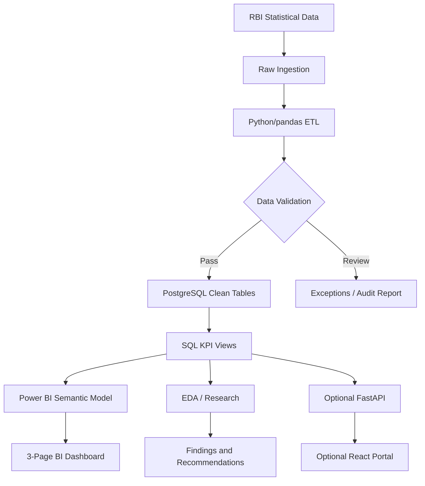
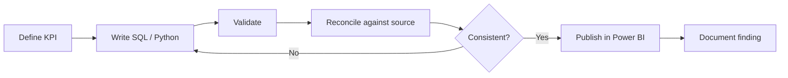

# CreditLens — Complete Project Blueprint

**Project:** CreditLens — Indian Banking & Credit Portfolio Analytics  
**Document type:** Product Requirements Document (PRD), Technical Design, Data Analytics Specification, and Execution Plan  
**Repository:** [Hiren1604/DA-Project](https://github.com/Hiren1604/DA-Project)  
**Primary dataset:** [Reserve Bank of India (RBI) — Industry-wise Deployment of Bank Credit](https://dbie.rbihub.in/tables?table=financial_sector.r188_industry_wise_deployment_of_bank_credit)  
**Domain:** Indian banking, credit markets, data analytics, business intelligence  
**Core stack:** Python, pandas, NumPy, SQL, PostgreSQL, Excel, Power BI, Power Query, DAX  
**Optional stack:** FastAPI, React, TypeScript, Tailwind CSS, Recharts, GitHub Actions  
**Status note:** The project owner has stated that CreditLens is complete. This document provides a full product and implementation specification, including recommended upgrades. Features, row counts, findings, and technologies described below should be checked against the repository before being represented as implemented.

---

## Table of Contents

1. [Executive Summary](#1-executive-summary)
2. [Problem Statement and Product Vision](#2-problem-statement-and-product-vision)
3. [Dataset and Source Governance](#3-dataset-and-source-governance)
4. [Technology Stack](#4-technology-stack)
5. [Product Requirements Document (PRD)](#5-product-requirements-document-prd)
6. [Architecture and Repository Structure](#6-architecture-and-repository-structure)
7. [Data Ingestion, Cleaning, and ETL](#7-data-ingestion-cleaning-and-etl)
8. [Exploratory Data Analysis (EDA)](#8-exploratory-data-analysis-eda)
9. [KPI Definitions and SQL Analytics](#9-kpi-definitions-and-sql-analytics)
10. [Power BI Dashboard Design](#10-power-bi-dashboard-design)
11. [UI Design and UX Guidelines](#11-ui-design-and-ux-guidelines)
12. [Optional React + FastAPI Portal](#12-optional-react--fastapi-portal)
13. [Business Insights and Analytical Storytelling](#13-business-insights-and-analytical-storytelling)
14. [Expanded Indian Credit Market Dataset](#14-expanded-indian-credit-market-dataset)
15. [Detailed Implementation and Execution Plan](#15-detailed-implementation-and-execution-plan)
16. [Testing, QA, and Acceptance Criteria](#16-testing-qa-and-acceptance-criteria)
17. [Deployment and GitHub Presentation](#17-deployment-and-github-presentation)
18. [Interview Explanation and Resume Positioning](#18-interview-explanation-and-resume-positioning)
19. [Project Deliverables and Final Checklist](#19-project-deliverables-and-final-checklist)
20. [Sources and Methodology Notes](#20-sources-and-methodology-notes)

---

## 1. Executive Summary

CreditLens is an end-to-end analytics and reporting system that transforms publicly available **Indian banking credit data** into validated financial KPIs, trend analyses, and interactive business intelligence dashboards.

The workflow covers:

```text
RBI Data (CSV / JSON)
    ↓
Python Acquisition + Source Metadata
    ↓
Data Profiling / Cleaning / Validation
    ↓
PostgreSQL Cleaned Data Model
    ↓
SQL Views + KPI Calculations
    ↓
EDA + Statistical Analysis
    ↓
Power BI Reports + DAX
    ↓
Research Findings + Business Recommendations
```

The intended business value is to make sector-wise lending exposure, industry allocation, credit growth, and concentration patterns accessible without manually processing raw banking spreadsheets every time.

**What the project can measure:** Outstanding credit, absolute and percentage growth, industry distribution, credit concentration, changes in sector share, reporting gaps, and unusual observations.

**What it cannot measure from this dataset alone:** Individual borrower defaults, probability of default, loan approvals, repayments, delinquency, individual credit scores, or realized portfolio losses. RBI's industry-wise source is an **aggregate banking series**, not a loan-level transactional dataset.

## 2. Problem Statement and Product Vision

### 2.1 Problem

RBI banking tables contain detailed historical statistics, but analysts must perform extraction, cleaning, period alignment, hierarchy handling, SQL transformation, and validation before reaching trustworthy findings. Different reporting dates or category hierarchies can produce inconsistent conclusions if this process is done manually.

### 2.2 Vision

> Enable analysts and finance decision-makers to explore Indian bank-credit trends through one reliable, auditable, and interactive reporting workflow.

### 2.3 Questions CreditLens should answer

- Which industries hold the greatest amount of outstanding bank credit?
- What is the month-over-month and year-over-year growth in credit outstanding?
- Which industries are gaining or losing share of the industrial-credit portfolio?
- Has credit concentration increased or decreased over time?
- Which periods or categories contain abrupt changes worth investigating?
- How did trends behave before and after documented methodology or reporting changes?

### 2.4 User personas

| Persona | Primary need | Relevant feature |
|---|---|---|
| Data Analyst | Reproducible transformations and queryable records | ETL scripts and SQL views |
| Credit/Banking Research Analyst | Sector-wise trends and allocation | Sector explorer and historical comparisons |
| Risk Research Analyst | Exposure concentration | HHI, top-sector share, anomaly analysis |
| Business Manager | Fast high-level reporting | Executive dashboard and insights |
| Data Quality Reviewer | Reliable calculations and traceability | Validation report, source metadata, warnings |

---

## 3. Dataset and Source Governance

### 3.1 Primary Indian dataset

**Title:** RBI — Industry-wise Deployment of Bank Credit  
**Official table:** https://dbie.rbihub.in/tables?table=financial_sector.r188_industry_wise_deployment_of_bank_credit  
**Publisher:** Reserve Bank of India (RBI)  
**Historical coverage:** Published series starts in April 2007; available end dates depend on the selected extract and update.  
**Unit:** ₹ crore for outstanding credit.  
**Format:** RBI-hosted exports / statistical tables; exact exported schema should be inspected during ingestion.

A convenient third-party, RBI-attributed long-format extract is available at:

https://dataful.in/datasets/17634/

At the time of the prior research, this extract was described as containing approximately **10,019 observations, five columns, 233 reporting dates, 20 industry categories, and 23 subcategories**. These are **published-source figures, not independently verified processed counts in the user's repository**, and may change if the export updates.

### 3.2 Example long-format schema

| Field | Meaning | Expected type |
|---|---|---|
| `data_as_on` | Credit reporting date | Date |
| `category` | Industry category | String |
| `sub_category` | Industry subcategory | String |
| `amount` | Outstanding credit | Decimal |
| `unit` | Reporting unit | String |

The actual export may use different names and structure. The ingestion script should normalize it to the analytical schema rather than assuming the raw file matches these exact headers.

### 3.3 Data hierarchy matters

RBI credit tables can include parent sector totals together with nested component subcategories.

**Do not add a parent-sector total to its own children.** That double-counts exposure. Store hierarchy metadata (`parent_sector`, `hierarchy_level`, `is_parent_total`) and define explicitly which mutually exclusive level is used by each KPI.

### 3.4 Historical comparability and limitations

Methodological / reporting changes, category reclassification, and bank mergers may create apparent discontinuities. The source notes include a change around **January 2019** and an impact associated with bank merger/reporting coverage from **July 2023**; confirm the relevant source notes for the exact series and extract used.

Analyses spanning a structural break must use clear annotations and may require separate time windows. RBI coverage describes the institutions reporting to that particular series; do not automatically generalize to every Indian lender or all NBFCs.

### 3.5 Source governance fields

Capture at minimum:

- `source_name` and `source_url`
- `downloaded_at_utc`
- `reporting_period_min` and `reporting_period_max`
- `file_sha256`
- `raw_filename`
- `source_release_notes`
- `ingestion_version`
- `known_comparability_breaks`

Preserve the original downloaded file unchanged.

---

## 4. Technology Stack

| Layer | Technology | Purpose |
|---|---|---|
| Retrieval | RBI CSV/JSON, Python Requests | Source acquisition and metadata |
| Transformation | Python, pandas, NumPy | Cleaning, unpivoting, aggregation, validation |
| Data storage | PostgreSQL | Structured historical facts and lookup tables |
| Analytics | SQL, CTEs, window functions | Time-series comparisons and KPI views |
| EDA | pandas, Matplotlib, Seaborn, SciPy | Distributions, trend plots, anomaly investigations |
| Reporting | Power BI Desktop | Interactive multi-page business dashboard |
| BI semantics | Power Query, DAX | Transformations, relationships, reusable measures |
| Cross-checking | Microsoft Excel | PivotTables and independent formula reconciliation |
| Testing | pytest, optionally Pandera | Automated data-quality and transformation checks |
| Documentation | Markdown, Jupyter, GitHub | Reproducibility, insights and presentation |
| Optional API | FastAPI | Validated aggregate data endpoints |
| Optional UI | React, TypeScript, Tailwind, Recharts | Web analytics portal |
| Optional CI | GitHub Actions | Run tests and linting automatically |

**Guidance:** Make the Python + SQL + Power BI pipeline complete before spending time on optional frontend/cloud features. Complex distributed systems add little value for this dataset scale.

---

## 5. Product Requirements Document (PRD)

### 5.1 Product scope

**In scope:** RBI data extraction, historical credit cleaning, reproducible ETL, PostgreSQL tables, SQL KPIs, EDA, a three-page Power BI report, and evidence-based business findings.

**Out of scope:** Loan underwriting, customer-specific recommendations, live loan transaction processing, customer PII, individual default prediction, claims of risk-adjusted profitability without loss data.

### 5.2 Functional requirements

| ID | Requirement | Priority | Acceptance outcome |
|---|---|---|---|
| FR-01 | Ingest RBI files | P0 | Sources and metadata retained |
| FR-02 | Standardize schema | P0 | Uniform dates, units, categories |
| FR-03 | Check data quality | P0 | Invalid and missing observations flagged |
| FR-04 | Persist relational dataset | P0 | Indexed, traceable tables |
| FR-05 | Create KPI layer | P0 | Eight documented KPI definitions |
| FR-06 | Executive overview | P0 | Total, growth, sector share, trend |
| FR-07 | Sector exploration | P0 | Industry drilldown and comparison |
| FR-08 | Historical comparison | P0 | Period-over-period metrics |
| FR-09 | Data quality view | P1 | User can inspect quality flags |
| FR-10 | Export filtered summaries | P1 | CSV/Excel export possible |
| FR-11 | Repeatable source refresh | P2 | Versioned ingestion and checks |
| FR-12 | Findings report | P1 | Quantified, caveated business insights |

### 5.3 Non-functional requirements

- **Correctness:** SQL, Excel and Power BI calculations must reconcile.
- **Auditability:** Every visual or measure maps to a documented definition and data source.
- **Reproducibility:** A new user can run cleaning/tests from provided setup instructions.
- **Usability:** Filters, dates, units and calculation methods are self-explanatory.
- **Performance:** Report interactions should remain responsive on the expected dataset size.
- **Resilience:** Bad records are isolated or flagged rather than silently dropped.
- **Portability:** SQL scripts, Python scripts, data dictionary and BI reports are version controlled.

### 5.4 Success criteria

- Reproducible source-to-report workflow.
- Eight consistently defined credit KPIs.
- Three usable report views: Executive Overview, Sector Exposure, Historical Trends & Quality.
- Independent reconciliation of critical measures.
- Five or more evidence-backed findings with dates and numerical context.
- Clear methodological caveats and limitations.

The KPI count, dashboard page count and findings target are **design targets unless separately verified in implementation**.

---

## 6. Architecture and Repository Structure

### 6.1 Logical architecture



### 6.2 Recommended target repository structure

This is a proposed structure and **not a verified representation of the current repository**.

```text
CreditLens/
├── README.md
├── requirements.txt
├── .env.example
├── .gitignore
├── data/
│   ├── raw/
│   ├── interim/
│   └── processed/
│       ├── credit_clean.csv
│       ├── sector_monthly_metrics.csv
│       └── data_quality_report.csv
├── notebooks/
│   ├── 01_data_profiling.ipynb
│   ├── 02_cleaning_eda.ipynb
│   ├── 03_sector_analysis.ipynb
│   └── 04_statistical_analysis.ipynb
├── src/
│   ├── ingest.py
│   ├── clean.py
│   ├── validate.py
│   ├── transform.py
│   ├── load.py
│   └── pipeline.py
├── sql/
│   ├── 01_schema.sql
│   ├── 02_load_checks.sql
│   ├── 03_kpi_views.sql
│   └── 04_analysis_queries.sql
├── powerbi/
│   ├── CreditLens.pbix
│   └── dax_measures.md
├── excel/
│   └── kpi_reconciliation.xlsx
├── reports/
│   ├── eda_report.md
│   ├── business_findings.md
│   └── data_dictionary.md
├── assets/
│   └── dashboard_screenshots/
└── tests/
    ├── test_cleaning.py
    ├── test_validation.py
    └── test_kpis.py
```

### 6.3 Database model

Suggested tables:

**`dim_sector`**
- `sector_id`, `sector_name`, `parent_sector_id`, `hierarchy_level`, `is_parent_total`

**`dim_date`**
- `date_id`, `calendar_date`, `reporting_month`, `year`, `quarter`

**`dim_source`**
- `source_id`, `source_url`, `downloaded_at_utc`, `publication_notes`, `version`

**`fact_credit_outstanding`**
- `observation_id`, `date_id`, `sector_id`, `source_id`, `credit_outstanding_cr`, `quality_status`

**`data_quality_exceptions`**
- `observation_id`, `rule_id`, `severity`, `error_details`, `review_status`

The natural uniqueness key should include source/reporting series, period, and sector-level identifiers. Use indices on month and sector for faster analysis.

---

## 7. Data Ingestion, Cleaning, and ETL

### Step 1: Extract

- Retrieve CSV or JSON from the chosen RBI export.
- Preserve raw bytes and a SHA-256 file hash.
- Create a `source_metadata.json` with source and reporting coverage.
- Detect whether the source is wide or long format.

### Step 2: Profile

Profile row count, columns, types, category counts, subcategory counts, date range, missing values, invalid numeric fields, duplicates, and hierarchy consistency.

### Step 3: Transform

- Rename columns into canonical snake_case.
- Parse dates consistently.
- Convert credit amounts into numeric ₹ crore values.
- Normalize categories with a transparent mapping table.
- Unpivot wide data where required.
- Retain hierarchy levels so totals and children cannot be combined incorrectly.
- Preserve missing values, and distinguish unknown/missing from true zero.

### Step 4: Validate

| Data issue | Rule | Handling |
|---|---|---|
| Invalid date | Cannot be parsed | Flag for review |
| Missing amount | No numeric amount | Preserve null and flag |
| Negative outstanding | Unexpected negative value | Investigate and flag |
| Duplicate series-month | Multiple conflicting records | Quarantine or reconcile |
| Inconsistent sector spelling | Different labels for same sector | Apply documented mapping |
| Missing month | Historical gap | Flag; avoid naive comparisons |
| Parent/child double-count risk | Mixed levels in aggregation | Filter to comparable level |
| Structural methodology change | Cross-break comparison | Annotate or split periods |

### Step 5: Load

- Write processed observations into PostgreSQL using explicit data types.
- Preserve source IDs, hierarchy metadata, and validation state.
- Create analytical views over validated sector-level totals.
- Export a data quality report to CSV or Markdown.

### Step 6: Enrich

Suggested derived fields:

| Field | Why it exists |
|---|---|
| `reporting_month` | Monthly historical join key |
| `reporting_year` | Annual aggregation |
| `sector_group` | Standard category |
| `hierarchy_level` | Prevent double counting |
| `credit_outstanding_cr` | Standardized amount |
| `previous_month_credit_cr` | MoM base |
| `previous_year_credit_cr` | YoY base |
| `mom_growth_pct` | Short-term growth |
| `yoy_growth_pct` | Annual growth |
| `sector_share_pct` | Exposure allocation |
| `historical_peak_flag` | Identify new observed highs |
| `quality_flag` | Interpretability and trust |

### Example Python cleaning function

```python
import pandas as pd


def clean_rbi_credit(df: pd.DataFrame) -> pd.DataFrame:
    required = {"data_as_on", "category", "sub_category", "amount"}
    missing = required - set(df.columns)
    if missing:
        raise ValueError(f"Missing columns: {missing}")

    data = df.copy()
    data["reporting_date"] = pd.to_datetime(
        data["data_as_on"], dayfirst=True, errors="coerce"
    )
    data["category"] = data["category"].astype("string").str.strip()
    data["sub_category"] = data["sub_category"].astype("string").str.strip()
    data["credit_outstanding_cr"] = pd.to_numeric(
        data["amount"].astype("string").str.replace(",", "", regex=False),
        errors="coerce",
    )
    data["reporting_month"] = data["reporting_date"].dt.to_period("M")
    data["quality_flag"] = "valid"
    invalid = (
        data["reporting_date"].isna()
        | data["category"].isna()
        | data["credit_outstanding_cr"].isna()
        | (data["credit_outstanding_cr"] < 0)
    )
    data.loc[invalid, "quality_flag"] = "review"
    return data
```

**Note:** This illustrative helper assumes already-normalized field names. The production ETL should map the actual downloaded file into those names and write flagged records to an exceptions table, not silently remove them.

---

## 8. Exploratory Data Analysis (EDA)

### 8.1 Why EDA matters

EDA should precede dashboard design. It reveals data-quality constraints and analytical patterns, and establishes which KPIs can be responsibly interpreted.

### 8.2 EDA checklist

1. Describe dataset shape, column semantics, types and source provenance.
2. Inspect null rates, date gaps, duplicated reporting keys and category hierarchies.
3. Check distributions of outstanding credit across sectors and reporting periods.
4. Plot historical trends for top sectors.
5. Analyze absolute and percentage growth, using only comparable observations.
6. Calculate sector shares and top-three concentration.
7. Compute HHI on mutually exclusive industry categories.
8. Identify large unusual changes and inspect methodology notes.
9. Compare indexed sector trends from a shared baseline.
10. Summarize findings, limitations and next investigations.

### 8.3 Proposed analytical chart inventory

| Chart | X/Y dimensions | Analytical purpose |
|---|---|---|
| Credit over time | Reporting month / ₹ crore | Historical trajectory |
| Ranked sector exposure | Industry / ₹ crore | Largest exposure sectors |
| YoY growth bars | Industry / % | Relative annual growth |
| Monthly growth heatmap | Month × year / % | Seasonal and abnormal periods |
| Top-sector share area chart | Time / allocation % | Structural allocation shifts |
| HHI trend | Month / index | Concentration movement |
| Indexed sector lines | Time / base-100 index | Relative growth comparison |
| Correlation heatmap | Comparable sector growth series | Descriptive co-movement |
| Outlier time series | Time / growth percentage | Anomaly investigation |
| Data completeness matrix | Sector × month | Reporting coverage |

### 8.4 Key investigative questions

- Are the largest exposures also the fastest growing?
- Which sectors gain share while others lose share?
- Is concentration increasing even if the total credit market expands?
- Do extreme changes reflect economic events, classification changes, or missing values?
- Which sector growth patterns appear persistent versus short-lived?
- Does using a different start/end date materially change conclusions?

### 8.5 Statistical methods

- Descriptive statistics: min, max, median, percentiles, standard deviation.
- Time-series comparisons: indexed values, rolling average, growth and volatility.
- Outlier detection: robust z-scores or median absolute deviation, with validation.
- Correlation: descriptive co-movement, not causation.
- Concentration: top-three share and HHI.
- Sensitivity analysis: period choice, missing values, source revisions.

**Avoid shoehorning in A/B testing or borrower-level default prediction** when the dataset does not support such claims.

### 8.6 EDA deliverables

- Profiling notebook and quality report.
- Cleaned dataset dictionary.
- At least six interpretable charts.
- Historical caveat log.
- Five or more specific, quantitative business findings derived from actual outputs.

---

## 9. KPI Definitions and SQL Analytics

### 9.1 Eight core KPIs

| KPI | Calculation | Business meaning |
|---|---|---|
| Total industry credit outstanding | Sum/official industry total at the correct hierarchy | Total observed credit exposure |
| MoM credit growth | `(C_t - C_(t-1)) / C_(t-1) × 100` | Near-term credit movement |
| YoY credit growth | `(C_t - C_(t-12)) / C_(t-12) × 100` | Annual lending expansion |
| Absolute credit change | `C_t - C_previous` | Movement measured in ₹ crore |
| Largest exposure sector | `argmax(sector_credit)` | Leading industry exposure |
| Sector share | `sector_credit / total_industry_credit × 100` | Relative exposure |
| Top-three concentration | Sum of top three mutually exclusive industry shares | Exposure concentration |
| HHI | Sum of squared sector fractional shares | Overall industry concentration |

**Important:** These are credit-outstanding and distribution measures, **not loan performance/default KPIs**. Use comparable reporting periods and a consistent numerator/denominator.

### 9.2 HHI definition

If sector fractions are `s_i` and sum to 1:

```text
HHI = Σ(s_i²)
```

With percentages rather than fractions, the scale differs by 10,000. State your convention explicitly.

### 9.3 Example year-over-year SQL query

Assumes a materialized analytical table `sector_monthly_credit`, containing one row per sector per normalized reporting month.

```sql
SELECT
    curr.reporting_month,
    curr.sector_name,
    curr.credit_outstanding_cr AS current_credit,
    prev.credit_outstanding_cr AS previous_year_credit,
    ROUND(
        100.0 * (
            curr.credit_outstanding_cr - prev.credit_outstanding_cr
        ) / NULLIF(prev.credit_outstanding_cr, 0),
        2
    ) AS yoy_growth_pct
FROM sector_monthly_credit AS curr
LEFT JOIN sector_monthly_credit AS prev
    ON curr.sector_name = prev.sector_name
   AND prev.reporting_month =
       (curr.reporting_month - INTERVAL '1 year')::date
WHERE curr.hierarchy_level = 'sector_total'
  AND curr.is_valid = TRUE
ORDER BY curr.reporting_month DESC, yoy_growth_pct DESC;
```

This deliberately joins on calendar periods rather than using `LAG(12)` blindly: `LAG(12)` may compare the wrong periods if the series is incomplete. A production version must also check comparability flags across methodology changes.

### 9.4 DAX measures

Assume a properly modeled `FactCredit`, `DimSector`, and continuous `'Date'` table.

```dax
Total Credit (₹ Cr) =
SUM(FactCredit[CreditOutstandingCr])

Credit Previous Year =
CALCULATE(
    [Total Credit (₹ Cr)],
    DATEADD('Date'[Date], -1, YEAR)
)

YoY Growth % =
DIVIDE(
    [Total Credit (₹ Cr)] - [Credit Previous Year],
    [Credit Previous Year]
)

Sector Share % =
DIVIDE(
    [Total Credit (₹ Cr)],
    CALCULATE(
        [Total Credit (₹ Cr)],
        REMOVEFILTERS(DimSector)
    )
)
```

Ensure the fact table used for these measures contains **one non-overlapping reporting level**, not both parent totals and their children. For certain filters, `REMOVEFILTERS(DimSector)` may need tailoring so geography, reporting scope and time remain controlled correctly.

### 9.5 KPI reconciliation

Build an Excel workbook with an RBI source tab, cleaned sample records, PivotTables, lookup checks and manually recomputed KPIs. Compare representative periods and sectors with SQL and Power BI results to the agreed rounding precision.

---

## 10. Power BI Dashboard Design

### Design goal

A **three-page, desktop-first report** combining financial precision with simple navigation and strong analytical context.

### Page 1 — Executive Credit Overview

**User question:** What is happening to overall observed industrial credit?

Content:

- KPI cards: credit outstanding, YoY growth, MoM growth, top-three concentration.
- Historical total credit chart.
- Top industry exposure bar chart.
- Sector / month filters.
- Brief analyst findings panel.
- Visible reporting date and RBI provenance note.

**Interactions:** Synchronized filters; clicking a top sector can cross-filter related visuals; a reset filter control.

### Page 2 — Sector Exposure & Concentration

**User question:** Where is credit concentrated, and which sectors are gaining share?

Content:

- Ranked sector exposure bars.
- Hierarchical industry breakdown with parent/child controls.
- Sector share time series.
- Top-three concentration summary.
- HHI trend.
- Comparison matrix with ₹ crore, MoM, YoY and share change.

**Interactions:** Sector drillthrough, dynamic comparison periods, readable tooltips and a hierarchy breadcrumb.

### Page 3 — Historical Trends & Data Quality

**User question:** How have patterns evolved and what can be trusted?

Content:

- Multi-year sector trend comparisons.
- MoM/YoY heatmap.
- Indexed growth chart (common base of 100).
- Data-quality flags and missing-month summary.
- Methodology-change annotations.
- Analyst conclusions and limitations.

**Interactions:** Hover to inspect source date/value, drill to quality exceptions, select periods, export filtered results.

### Dashboard wireframe (conceptual)

```text
+-------------------------------------------------------------------+
| CreditLens                 RBI Banking Intelligence    Period [v]  |
+-------------------------------------------------------------------+
| Total Credit | YoY Growth | MoM Growth | Top 3 Share               |
+-------------------------------------------------------------------+
| Historical Credit Trend              | Largest Sectors            |
| [line chart]                         | [ranked bar chart]         |
+-------------------------------------------------------------------+
| Important Findings / Risks / Reporting Caveats                     |
+-------------------------------------------------------------------+
| Source: RBI | As-of period: [date] | Notes | Download              |
+-------------------------------------------------------------------+
```

---

## 11. UI Design and UX Guidelines

### 11.1 Visual personality

Professional Indian-finance BI interface. It should feel like an institutional research dashboard, not a decorative crypto trading app.

**Suggested palette:**

| Role | Hex | Usage |
|---|---|---|
| Deep navy | `#101C30` | Header, optional dark navigation |
| Slate blue | `#233B59` | Surfaces and secondary emphasis |
| Cyan | `#06B6D4` | Active analytical selection |
| Teal | `#14B8A6` | Positive directional emphasis |
| Amber | `#F59E0B` | Cautions / abnormal values |
| Neutral off-white | `#F8FAFC` | Main light canvas |

Use neutral text and chart labels. Do not rely solely on red/green coloring to convey a metric.

### 11.2 Typography

- Clean sans-serif for UI headings and labels.
- Tabular numerals for metric cards.
- Large, aligned metric values with smaller units.
- Explicit ₹ crore units and consistent percentage precision.
- Readable chart titles phrased as questions or claims.

### 11.3 Interaction design

- Global reporting-period selection persists across pages.
- Sector filters use a known hierarchy.
- Users can clear all filters in one click.
- Tooltips explain KPI definitions and comparison windows.
- Data gaps are shown as missing, not falsely interpolated into actual values.
- The dashboard defaults to the **latest available reporting month**, not an unsupported “live” state.
- Downloaded CSVs should reflect current filters and include the reporting date.
- Structural breaks should appear as annotations when relevant.

### 11.4 UX anti-patterns to avoid

- Showing a parent-sector total alongside its children and summing everything.
- Claiming data are live when published periodically.
- Rendering empty periods as zero.
- Using unlabeled percentage changes with unknown denominators.
- Showing dozens of charts on one page.
- Putting analysis explanations only in a README while dashboard values remain unexplained.

---

## 12. Optional React + FastAPI Portal

The Power BI report alone is sufficient for the analytics project. If building a custom product, treat it as an additional, thin visualization layer on top of **the same validated KPIs**.

### Optional web stack

- React + TypeScript + Vite
- Tailwind CSS + accessible UI components
- Recharts or ECharts
- FastAPI backend
- PostgreSQL
- Optional SQLAlchemy and Pydantic

### Suggested navigation

1. Executive Overview
2. Sector Explorer
3. Historical Analysis
4. Data Quality
5. Methodology

### Example REST API contract

| Endpoint | Returns |
|---|---|
| `GET /api/summary` | Credit KPI cards and reporting period |
| `GET /api/sectors` | Sector hierarchy |
| `GET /api/credit/trends` | Credit trend series |
| `GET /api/credit/comparison` | Sector-by-period comparisons |
| `GET /api/data-quality` | Exceptions and completeness metrics |
| `GET /api/metadata` | Source version, notes, reporting dates |

Avoid duplicating KPI calculations in React components; serve validated backend metrics.

---

## 13. Business Insights and Analytical Storytelling

The most valuable final deliverable is a **findings report grounded in actual RBI-derived numbers**.

For each insight:

1. State the observation and reporting period.
2. Quantify the change in ₹ crore and/or %.
3. Compare it with an appropriate baseline.
4. Verify methodological comparability and source completeness.
5. Explain the analytical implication without overstating causality.
6. Suggest what an analyst would investigate next.

### Illustrative insight — not an actual RBI finding

> A manufacturing subsector's outstanding credit rose **14% YoY**, compared with **8%** for the comparable industrial total. Its share increased by **0.6 percentage points**. The pattern suggests a shift in industry credit exposure and motivates closer examination of concentration and sector-specific economic conditions.

**Do not copy these fictional figures into the final README as real findings.** Replace them with computed results and cite reporting dates.

### Findings template

```markdown
#### Finding 1: [Specific observed pattern]
- Reporting period: YYYY-MM
- Sector: [sector]
- Current credit outstanding: ₹[value] crore
- Comparison amount: ₹[value] crore
- Absolute change: ₹[value] crore
- Percentage change: [value]%
- Supporting chart: [link]
- Interpretation: [evidence-based description]
- Limitation: [coverage, missing data, reclassification, etc.]
- Follow-up recommendation: [analysis or monitoring action]
```

---

## 14. Expanded Indian Credit Market Dataset

**Optional supplementary dataset:** RBI month-wise deployment of bank credit to major sectors, accessible via:

https://dataful.in/datasets/17836/

The previously reviewed extract was described as covering approximately **9,510 observations**, five columns, and major credit categories including **Agriculture, Industry, Services, Personal Loans, and Priority Sector**. This is source-reported context, not a verified project ingestion count.

### Why it helps

It allows a broader **Indian credit-market overview** alongside the detailed **industry-specific credit analytics** module. In particular, trends in aggregate personal loans have more immediate domain relevance to Indian consumer-finance firms than industrial subcategories alone.

### Data modeling caution

Do **not** merge these two extracts into a single additive fact table without verifying source populations, definitions, and reporting periods. They may overlap and are intended for different analytical views. Keep separately labeled modules:

- **Module A:** Industry Credit Intelligence.
- **Module B:** Broad Credit Market / Personal Loans Overview.

---

## 15. Detailed Implementation and Execution Plan

This plan can be used to audit or improve an already-completed version of CreditLens. It is **not a statement that these tasks are outstanding**.

| Phase | Approximate effort | Work | Deliverable |
|---|---:|---|---|
| 1. Dataset Audit | 4–6 h | Source selection, profiling, definitions, structural breaks | Data audit report |
| 2. ETL & Validation | 6–8 h | Normalize, clean, validate, preserve exceptions | Repeatable Python pipeline |
| 3. SQL & KPI Layer | 5–7 h | Tables, views, eight KPI definitions, reconciliation | SQL analytics model |
| 4. EDA & Research | 6–8 h | Exposure trends, outliers, concentration, findings | Notebooks and insights |
| 5. Power BI | 6–9 h | Three pages, DAX, filters, drilldowns, UX | `.pbix` report |
| 6. QA & Packaging | 4–6 h | Tests, README, images, reproducibility | Portfolio-ready GitHub repository |
| **Total** | **31–44 h** | Estimates depend on source consistency and experience | Complete deliverable |

### Phase 1: Dataset audit

- Verify download URLs and actual available data dates.
- Confirm units, categorization, and missing-value conventions.
- Write data dictionary and source caveat notes.
- Create baseline profiling notebook.

### Phase 2: ETL and validation

- Write idempotent ingestion logic.
- Normalize the hierarchy and report dates.
- Create reusable transformations and tests.
- Export cleaned data and data-quality exceptions.

### Phase 3: Relational modeling and KPIs

- Implement dimension/fact schema.
- Load PostgreSQL tables.
- Build SQL KPI views with comparable-period joins.
- Reconcile results against source and Excel samples.

### Phase 4: EDA and insights

- Produce growth, distribution, concentration and anomaly charts.
- Investigate discontinuities.
- Write five or more insights with citations and exact source periods.

### Phase 5: BI reporting

- Build three report pages.
- Add DAX measures and cross-filter behavior.
- Display source metadata.
- Validate totals, page interactions, and tooltip text.

### Phase 6: QA and GitHub

- Run tests and reproducibility checks.
- Add dashboard screenshots.
- Document setup steps and limitations.
- Prepare a short interview demo narrative.

### Recommended development loop



---

## 16. Testing, QA, and Acceptance Criteria

| Area | Test | Expected result |
|---|---|---|
| Ingestion | Repeat ingestion on identical source | Deterministic data and metadata |
| Schema | Required fields and expected dtypes | Valid canonical schema |
| Uniqueness | Repeated source/sector/month observations | No unexplained duplicate natural keys |
| Numeric validity | Missing, unparseable, negative amounts | All flagged |
| Historical gaps | Check sector/month coverage | Gaps surfaced, not hidden |
| Hierarchy | Compare totals vs children | No double counting |
| Growth | Test MoM/YoY on known examples | Correct denominator and date alignment |
| Comparability | Inspect flagged methodology boundaries | Incompatible comparisons annotated |
| Cross-tool agreement | SQL vs Excel vs Power BI | Match to selected rounding precision |
| Dashboard UX | Filter, reset, drillthrough, tooltip | Correct interaction and labels |
| Reproducibility | Clean environment walkthrough | Documented outputs regenerated |

**Quality target:** Zero unexplained duplicate keys, zero silently discarded invalid records, and internally consistent KPI formulas. Avoid arbitrary claims such as “99.9% accuracy” without a defensible accuracy definition.

### Example tests

```python
def test_missing_dates_are_flagged(clean_df):
    invalid = clean_df[clean_df["reporting_date"].isna()]
    assert (invalid["quality_flag"] == "review").all()


def test_valid_amounts_nonnegative(clean_df):
    valid = clean_df[clean_df["quality_flag"] == "valid"]
    assert (valid["credit_outstanding_cr"] >= 0).all()
```

These snippets illustrate testing standards; integrate them with actual fixtures and paths in the repository.

---

## 17. Deployment and GitHub Presentation

### 17.1 Local setup example

```powershell
git clone https://github.com/Hiren1604/DA-Project.git
cd DA-Project
python -m venv .venv
.\.venv\Scripts\Activate.ps1
pip install -r requirements.txt
```

This assumes the repository has `requirements.txt`. Verify the actual files before publishing these instructions.

A possible future pipeline entry point would be:

```powershell
python -m src.pipeline
```

**This is a proposed command, not an independently verified command in the current repository.** The README should use the actual implementation's entry point.

### 17.2 GitHub README structure

1. Project overview and business problem.
2. Dashboard screenshots and main features.
3. RBI data sources and period coverage.
4. Tools and architecture.
5. Data cleaning and quality rules.
6. Database design and SQL KPI definitions.
7. EDA visualizations and actual findings.
8. Power BI walkthrough.
9. Setup and reproducibility.
10. Limitations and improvement roadmap.

### 17.3 Deployment options

| Option | When to use it |
|---|---|
| Local PostgreSQL + Power BI | Core analyst portfolio demo |
| GitHub repository + static screenshots | Recruiter-accessible evidence |
| GitHub Actions | Automated checks and CI |
| Streamlit | Simple public analytical presentation |
| FastAPI + React on hosted services | Optional full product demo |
| BigQuery or hosted database | Optional cloud SQL experience |

**Recommendation:** Prioritize data correctness, findings and dashboard evidence over adding cloud complexity.

---

## 18. Interview Explanation and Resume Positioning

### Interview-ready project overview

> CreditLens is an end-to-end Indian banking credit analytics project based on historical data published by the Reserve Bank of India. I worked on transforming industry-wise bank-credit data into a clean, structured dataset, defining reproducible financial KPIs and presenting the results through interactive Power BI reporting. The central analyses focus on outstanding credit, industry allocation, historical growth and exposure concentration. One of the key challenges is maintaining data accuracy across missing observations, industry hierarchy levels and RBI reporting changes. The project demonstrates how raw public financial statistics can be turned into reliable, explainable business intelligence.

Use this only to the extent it accurately describes implemented work. Be prepared to show the relevant source files, SQL, dashboard, and numerical findings.

### Potential interview questions

1. What was the business problem and why did you choose the RBI dataset?
2. What is the grain of your fact table?
3. How did you avoid double-counting parent and child sectors?
4. How do you calculate YoY growth when months are missing?
5. Why is a change in credit outstanding not equivalent to loan disbursement?
6. How did you reconcile your SQL results with Power BI?
7. How did you deal with source methodology changes?
8. Which sector had the largest exposure in your final reporting period?
9. What are your top three findings, with actual figures?
10. Why can you not calculate borrower default rates from this dataset?

### Resume bullet directions

Once verified against actual code and dashboard outputs, a strong set of four bullets can emphasize:

- End-to-end pipeline using **real RBI Indian credit data** and Python/SQL.
- **Data cleaning, validation, and EDA** over the actual number of processed observations.
- **Eight defined financial KPIs** for credit growth, exposure and concentration (if implemented).
- **Three-page Power BI dashboard and quantified findings** (if implemented).

Use the **actual processed row count**, reporting period and verified numerical findings. Do not conflate the downloaded dataset's published size with rows successfully processed.

---

## 19. Project Deliverables and Final Checklist

### Minimum portfolio package

- [ ] Dataset source and RBI methodology notes cited.
- [ ] Real reporting coverage documented.
- [ ] Raw and cleaned datasets kept distinguishable.
- [ ] Data cleaning and validation pipeline reproducible.
- [ ] Data quality exceptions visible.
- [ ] PostgreSQL schema and SQL queries included.
- [ ] All implemented KPIs documented with formulas.
- [ ] Power BI pages match the claimed count and features.
- [ ] SQL/Excel/Power BI KPI reconciliation performed.
- [ ] EDA report includes real charts and real findings.
- [ ] Project screenshots and README are current.
- [ ] Setup instructions have been executed successfully.
- [ ] Resume claims match repository evidence.

### Strongest portfolio story

**Raw RBI data → trustworthy transformations → validated KPIs → exploratory findings → clear Power BI dashboards → decision-ready analysis.**

This workflow is more compelling than adding unrelated machine learning or infrastructure features without a genuine business need.

---

## 20. Sources and Methodology Notes

### Dataset links

- **RBI official statistical table:** https://dbie.rbihub.in/tables?table=financial_sector.r188_industry_wise_deployment_of_bank_credit
- **RBI statistical releases portal:** https://statistics.rbi.org.in/
- **RBI-attributed industry-wise extract:** https://dataful.in/datasets/17634/
- **RBI-attributed major-sector extract:** https://dataful.in/datasets/17836/
- **Project repository:** https://github.com/Hiren1604/DA-Project

### Verification and scope notes

- Source-reported dataset counts and reporting coverage are not evidence that the repository processed all published rows.
- The project owner confirmed completion, but this document was not produced from a verified line-by-line audit of the GitHub repository.
- The stack, API routes, target repository tree, optional frontend and some QA machinery are recommendations that may or may not already exist in the project.
- Eight KPIs and a three-page dashboard reflect the previously discussed feature specification; they should be verified against the actual implementation.
- Example analytical numbers used in this document are explicitly illustrative.
- RBI industry-wise credit outstanding is an aggregate measure, not customer-level loan performance.
- Historical series definitions and latest available dates should be verified against the exact downloaded export when executing the project.

---

*CreditLens — Indian Banking & Credit Portfolio Analytics. End of blueprint.*
