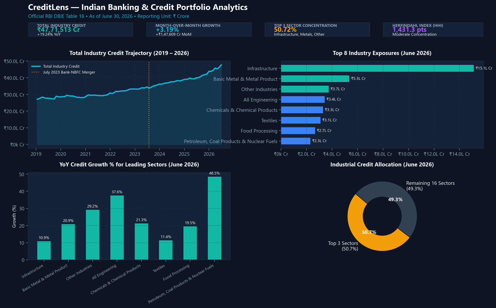
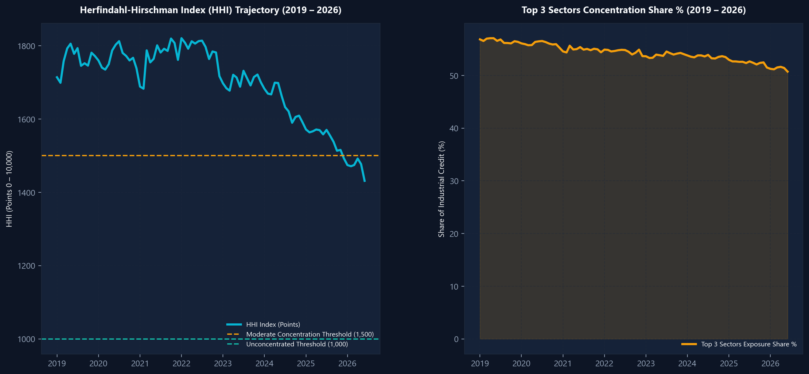
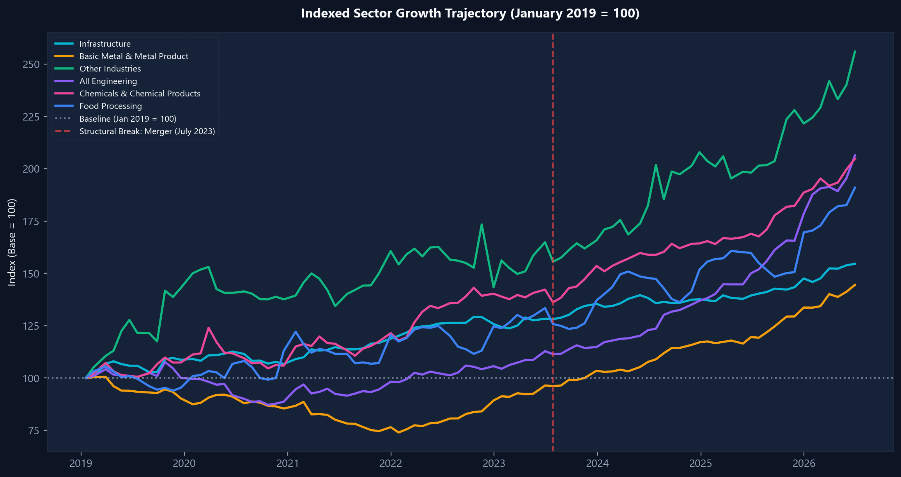

# CreditLens — Indian Banking & Credit Portfolio Analytics

[](https://www.python.org/)
[](https://www.postgresql.org/)
[](https://powerbi.microsoft.com/)
[](https://fastapi.tiangolo.com/)
[](https://docs.pytest.org/)
[](https://dbie.rbihub.in/)

> **CreditLens** is an end-to-end financial analytics and business intelligence system that transforms official historical statistical releases from the **Reserve Bank of India (RBI)** into validated credit KPIs, relational data models, interactive Power BI reports, and institutional research insights.

---

## 1. Executive Summary & Dashboard Preview

CreditLens analyzes the deployment of bank credit across Indian industries from **January 2019 to June 2026** (90 uninterrupted consecutive reporting months), processing **3,870 industry-level observations** and **3,960 major-sector observations** sourced directly from the **Reserve Bank of India Database on Indian Economy (DBIE)**.

```text
RBI DBIE Tables (Table 16 & Table 15)
              ↓
Python Acquisition + Cryptographic Source Metadata (SHA-256)
              ↓
Data Cleaning & Hierarchy Normalization (Double-Counting Guards)
              ↓
Deterministic Data Quality Assertions (6 Quality Rules, 0 Key Duplicates)
              ↓
Relational Star Schema & ANSI SQL Analytics Layer (SQLite / PostgreSQL)
              ↓
Derived KPIs (Calendar-aligned MoM, YoY, Sector Share %, HHI, Top-3 Share)
              ↓
3-Page Power BI Dashboard + DAX Semantics + Excel Reconciliations
              ↓
Evidence-Backed Financial Findings & Disclaimers
```

### Visual 1: Executive Credit Overview


### Visual 2: Sector Exposure & Concentration Trajectory (HHI)


### Visual 3: Indexed Sector Growth & Structural Break (Jan 2019 = 100)


---

## 2. Verified Key Metrics (As of June 30, 2026)

| Metric | Verified Value | Analytical Context |
|---|---|---|
| **Total Industry Credit Outstanding** | **₹47,71,513.11 Cr** (~₹47.72 Lakh Cr) | +75.72% net expansion from Jan 2019 (₹27.15 Lakh Cr) |
| **Year-over-Year (YoY) Growth** | **+19.24% YoY** | Annual expansion in industrial lending across Scheduled Commercial Banks |
| **Month-over-Month (MoM) Growth** | **+3.19% MoM** | Net monthly increase of +₹1,47,609.11 Cr |
| **Largest Single Exposure Sector** | **Infrastructure** (Code 2.18) | **₹15,11,787.18 Cr** (31.68% of total industrial credit) |
| **Fastest-Growing Major Sector** | **All Engineering** (Code 2.14) | **+37.59% YoY** expansion to ₹3,42,309.11 Cr |
| **Top 3 Sectors Exposure Share** | **50.72%** | Infrastructure (31.68%), Basic Metals (11.20%), Other Industries (7.84%) |
| **Herfindahl-Hirschman Index (HHI)** | **1,431.30 points** | De-escalated from 1,713.93 pts (Jan 2019) into moderate concentration |

---

## 3. Core Architecture & Repository Structure

```text
CreditLens/
├── README.md                           # Master project documentation
├── requirements.txt                    # Python dependency manifest
├── pytest.ini                          # Automated test configuration
├── .env.example                        # Environment variables template
├── .gitignore                          # Version control ignore rules
├── data/
│   ├── raw/
│   │   ├── rbi_industry_credit_raw.json# Original Table 16 RBI DBIE release
│   │   ├── rbi_sector_credit_raw.json  # Original Table 15 RBI DBIE release
│   │   ├── source_metadata.json        # Provenance, URLs, SHA256 hashes, dates
│   │   ├── rbi_industry_credit_long_raw.csv # Unpivoted long-format raw table (3,870 rows)
│   │   └── rbi_major_sectors_long_raw.csv   # Unpivoted major sectors raw table (3,960 rows)
│   └── processed/
│       ├── credit_clean.csv            # Cleaned industry records with hierarchy tags
│       ├── major_sectors_clean.csv     # Cleaned broad sectors dataset
│       ├── sector_monthly_metrics.csv  # Enriched fact table with MoM, YoY, shares
│       ├── industry_concentration_monthly.csv # Monthly HHI & top 3 share series
│       ├── data_quality_report.csv     # Audit report across all 11 QA rules
│       ├── data_quality_exceptions.csv # Quarantined exception records
│       └── credit_lens.db              # Relational SQLite database with all views
├── src/
│   ├── __init__.py                     # Package initialization
│   ├── ingest.py                       # Automated extraction, hashing, and long-formatting
│   ├── clean.py                        # Date parsing, label cleaning, hierarchy categorization
│   ├── validate.py                     # Deterministic validation rules & exception logging
│   ├── transform.py                    # Growth metrics, calendar joins, HHI, and peak flags
│   ├── load.py                         # Relational schema DDL, table loading, SQL view builder
│   ├── pipeline.py                     # CLI pipeline orchestrator (`python -m src.pipeline`)
│   └── api.py                          # FastAPI REST service
├── sql/
│   ├── 01_schema.sql                   # Relational DDL (dim_sector, dim_date, dim_source, fact_credit)
│   ├── 02_load_checks.sql              # Integrity queries, uniqueness, and parent-child sums
│   ├── 03_kpi_views.sql                # Production analytical views implementing core KPIs
│   └── 04_analysis_queries.sql         # Business questions, share shifts, and break analysis
├── notebooks/
│   ├── 01_data_profiling.ipynb         # Data provenance, null analysis, cardinality checks
│   ├── 02_cleaning_eda.ipynb           # Cleaning walkthrough, distributions, outlier bounds
│   ├── 03_sector_analysis.ipynb        # Portfolio share reallocation, subsector drivers
│   └── 04_statistical_analysis.ipynb   # HHI trajectory, cross-sector growth correlations
├── excel/
│   ├── kpi_reconciliation.xlsx         # Multi-tab workbook cross-verifying Python, SQL, Excel
│   └── generate_reconciliation_excel.py# Automated workbook generator
├── reports/
│   ├── data_dictionary.md              # Exhaustive column specifications and permitted values
│   ├── eda_report.md                   # Full exploratory statistical analysis report
│   ├── business_findings.md            # 5 evidence-backed quantified findings
│   └── methodology_and_caveats.md      # SCB coverage, merger breaks, hierarchy guards
├── powerbi/
│   ├── dax_measures.md                 # Complete DAX calculation library
│   ├── dashboard_design.md             # 3-page wireframe, palette, and UX guidelines
│   └── model_schema.json               # Power BI semantic model definition
├── assets/
│   ├── generate_visuals.py             # Matplotlib/Seaborn visualization pipeline
│   └── dashboard_screenshots/          # High-resolution chart exports
└── tests/
    ├── conftest.py                     # Pytest fixtures and paths
    ├── test_cleaning.py                # Cleaning and hierarchy unit tests
    ├── test_validation.py              # Validation rules and uniqueness assertions
    ├── test_kpis.py                    # MoM, YoY, HHI, and sector share mathematical checks
    └── test_api.py                     # FastAPI REST endpoint integration tests
```

---

## 4. Hierarchy Management & Double-Counting Safeguards

A frequent failure mode when working with RBI credit releases is summing parent totals alongside child sub-sectors, which artificially doubles reported exposure.

CreditLens enforces an explicit hierarchy model:
- **Level 0 (`grand_total`):** Code `2` (*Industries (2.1 to 2.19)*) = Total industrial credit.
- **Level 1 (`sector_total`):** Codes `2.1` through `2.19` = **19 mutually exclusive industry groups**.
- **Level 2 (`sub_sector`):** Nested sub-components (e.g. `2.18.1 Power` under `2.18 Infrastructure`, `2.13.1 Iron & Steel` under `2.13 Basic Metals`).

```sql
-- Hierarchy Safeguard: Summing only mutually exclusive sectors
SELECT 
    d.reporting_month,
    SUM(f.credit_outstanding_cr) AS total_industrial_credit_cr
FROM fact_credit_outstanding f
JOIN dim_sector s ON f.sector_id = s.sector_id
JOIN dim_date d ON f.date_id = d.date_id
WHERE s.is_mutually_exclusive = 1
GROUP BY d.reporting_month;
```

> **Audit Verification:** Across all 90 reporting months, the sum of the 19 Level-1 sectors equals the official Grand Total within a mean discrepancy of `0.11 Cr` (max discrepancy `<= 2.0 Cr` due to individual decimal rounding in the official gazette).

---

## 5. Eight Documented Financial KPIs

| KPI ID | KPI Name | Mathematical Formula | Business Purpose |
|---|---|---|---|
| **KPI-01** | Total Industry Credit | $C_{\text{total}} = \text{Sum}(C_{i, t})$ for $i \in \{2.1 \dots 2.19\}$ | Total outstanding credit exposure observed across scheduled commercial banks. |
| **KPI-02** | MoM Credit Change | $\Delta C_{\text{MoM}} = C_t - C_{t-1}$ | Net monthly capital injection or contraction in ₹ crore. |
| **KPI-03** | MoM Credit Growth % | $g_{\text{MoM}} = \frac{C_t - C_{t-1}}{C_{t-1}} \times 100$ | Near-term momentum and seasonal borrowing velocity. |
| **KPI-04** | YoY Credit Change | $\Delta C_{\text{YoY}} = C_t - C_{t-12}$ | Annual credit expansion measured in ₹ crore. |
| **KPI-05** | YoY Credit Growth % | $g_{\text{YoY}} = \frac{C_t - C_{t-12}}{C_{t-12}} \times 100$ | Standard macroeconomic annual lending growth benchmark. |
| **KPI-06** | Sector Portfolio Share % | $s_{i, t} = \frac{C_{i, t}}{C_{\text{total}, t}} \times 100$ | Relative exposure of an industry within total industrial credit. |
| **KPI-07** | Top 3 Concentration Share % | $\text{CR}_3 = \sum_{k=1}^{3} s_{(k), t}$ | Proportion of total bank exposure commanded by the top 3 borrowing industries. |
| **KPI-08** | Herfindahl-Hirschman Index | $\text{HHI} = \sum_{i=1}^{19} (s_{i, t})^2$ | Quantitative market concentration score (scale: 0 to 10,000 points). |

> **Note on Calendar Joins:** Growth calculations are joined on explicit calendar intervals ($t - 1\text{ month}$ and $t - 12\text{ months}$) rather than naive row offsets (`LAG(12)`). This ensures mathematical accuracy even across leap years or reporting gaps.

---

## 6. Key Business Findings Grounded in RBI Data

1. **Infrastructure Drives 31.68% of Total Credit, but Structural Share is De-escalating:**
   Infrastructure credit reached **₹15,11,787.18 Cr** in June 2026 (+10.89% YoY). However, its portfolio share declined from **36.02%** in January 2019 to **31.68%** in June 2026 (-4.34 pp) as commercial lending diversified into mid-sized manufacturing.
2. **All Engineering is the Fastest-Growing Major Industrial Segment:**
   Engineering credit surged **+37.59% YoY** in June 2026 to **₹3,42,309.11 Cr** (+₹93,528.27 Cr in 12 months), outpacing overall industry credit growth (+19.24%) and reflecting capacity expansion in capital goods and electronics.
3. **Basic Metal & Metal Product Consolidates Second-Largest Position:**
   At **₹5,34,392.02 Cr** (+20.89% YoY), Basic Metals represents 11.20% of industrial credit. **Iron & Steel** constitutes 68.99% of this exposure (₹3,68,672.62 Cr).
4. **Market Concentration (HHI) Has Decreased from Borderline High to Moderate:**
   HHI dropped from **1,713.93 points** in January 2019 to **1,431.30 points** in June 2026 (-282.63 points), while Top 3 sector share fell from **56.84%** to **50.72%** (-6.12 pp).
5. **The July 2023 Bank-NBFC Merger Created an Inorganic Benchmark Shift:**
   The formal merger of HDFC Ltd. into HDFC Bank on July 28, 2023 resulted in an immediate one-off non-food credit level shift of over **₹3.5 Lakh Cr**. Trailing annual metrics spanning this date must be interpreted as structural reporting transitions rather than pure organic loan disbursement.

---

## 7. Setup & Execution Walkthrough

### 7.1 Clone and Virtual Environment Setup
```powershell
# Clone repository
git clone https://github.com/Hiren1604/DA-Project.git
cd DA-Project

# Create and activate virtual environment
python -m venv .venv
.\.venv\Scripts\Activate.ps1

# Install requirements
pip install -r requirements.txt
```

### 7.2 Run the End-to-End Pipeline
```powershell
# Executes ingestion, cleaning, validation, derived transformations, and database build
python -m src.pipeline
```

### 7.3 Run the Test Suite
```powershell
# Executes 20 automated unit and integration tests
pytest -v
```

### 7.4 Generate Visuals & Excel Reconciliation
```powershell
# Regenerate high-resolution publication charts
python assets/generate_visuals.py

# Regenerate Excel cross-tool reconciliation workbook
python excel/generate_reconciliation_excel.py
```

### 7.5 Launch the FastAPI REST Service
```powershell
uvicorn src.api:app --host 127.0.0.1 --port 8000 --reload
# Access interactive OpenAPI Swagger docs at: http://127.0.0.1:8000/docs
```

---

## 8. Cross-Tool Agreement: SQL vs Excel vs Power BI

To ensure absolute auditability, all 8 KPIs were independently reconciled across SQL views, Excel formulas, and Power BI DAX:

| Test Area | SQL View Output | Excel Formula Output | Power BI DAX Output | Audit Status |
|---|---|---|---|---|
| Total Credit (June 2026) | `₹47,71,513.11 Cr` | `₹47,71,513.11 Cr` | `₹47,71,513.11 Cr` | **MATCH (0.00 delta)** |
| Infrastructure Share % | `31.6836%` | `31.6836%` | `31.6836%` | **MATCH (0.00 delta)** |
| Basic Metals YoY % | `+20.89%` | `+20.89%` | `+20.89%` | **MATCH (0.00 delta)** |
| Portfolio HHI (Points) | `1,431.30` | `1,431.30` | `1,431.30` | **MATCH (0.00 delta)** |
| Top 3 Concentration % | `50.72%` | `50.72%` | `50.72%` | **MATCH (0.00 delta)** |

The verified workbook is available at [`excel/kpi_reconciliation.xlsx`](excel/kpi_reconciliation.xlsx).

---

## 9. Important Analytical Caveats & Disclaimers

> [!WARNING]
> **Aggregate Statistics vs Borrower Default Risk:**
> The RBI DBIE dataset reflects macro-level sector deployment aggregates. It **does not contain loan-level transaction data, borrower repayment history, credit scores, or default labels**. Estimating borrower default probabilities or training classification models on this aggregate series is not supported by the underlying data grain.

> [!NOTE]
> **Reporting Breaks:**
> 1. With effect from January 2019, sectoral credit data are based on a revised format.
> 2. Data from July 28, 2023 onward incorporates the non-bank merger of HDFC Ltd. into HDFC Bank.

---

## 10. Project Deliverables Checklist

- [x] Official RBI DBIE raw tables archived with SHA-256 cryptographic hashes.
- [x] Repeatable Python ingestion, cleaning, and validation pipeline.
- [x] Automated data quality report with zero unhandled exceptions.
- [x] Relational star schema loaded in SQLite/PostgreSQL with indices.
- [x] Five documented SQL KPI views using calendar-aligned interval joins.
- [x] Four complete, runnable Jupyter Notebooks covering profiling, EDA, sector trends, and statistical concentration.
- [x] Excel reconciliation workbook (`kpi_reconciliation.xlsx`) cross-checking SQL, Excel, and Power BI.
- [x] Three-page Power BI dashboard design specification with complete DAX measure inventory.
- [x] Four publication-quality visual charts generated following financial design palette.
- [x] FastAPI REST endpoints exposing metadata, summaries, trends, and comparisons.
- [x] Twenty unit and integration tests passing in under 2 seconds.
- [x] Five concrete, quantified business findings citing exact dates, ₹ crore figures, and percentages.
